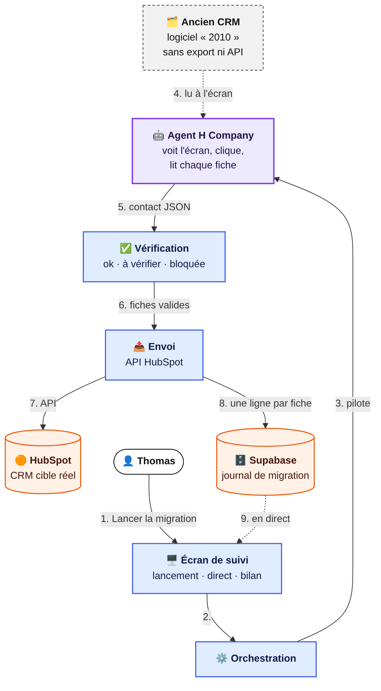

# Bascule

> **Changez de logiciel, sans perdre vos données.**

Bascule migre les fiches clients d'un vieux logiciel **sans export ni API** vers **HubSpot**. Un agent IA de **H Company** lit l'ancien logiciel **à l'écran, comme un humain**. Chaque fiche est ensuite **vérifiée**, **prouvée par une capture d'écran**, puis envoyée dans HubSpot. Les fiches douteuses sont bloquées avec leur raison.

Projet du **Hackathon Eugenia 2026 « Build The Future »** (16 → 20 novembre 2026), track *Creative Entrepreneur*, Team 8, avec H Company, Hugging Face et Vercel.

---

## Sommaire

- [Tester en 2 minutes](#tester-en-2-minutes)
- [Résultats réels](#résultats-réels)
- [Le problème](#le-problème)
- [Comment ça marche](#comment-ça-marche)
- [Ce qui rend Bascule fiable](#ce-qui-rend-bascule-fiable)
- [Architecture et technologies](#architecture-et-technologies)
- [Lancer le projet](#lancer-le-projet)
- [Structure du dépôt](#structure-du-dépôt)
- [Livrables](#livrables)
- [L'équipe](#léquipe)
- [Limites et suite](#limites-et-suite)

---

## Tester en 2 minutes

| | Lien | À faire |
|---|---|---|
| 1 | **Ancien CRM** (le logiciel à quitter) · [v1](https://projet-hackathon-uffi.vercel.app) · [v2](https://projet-hackathon-uffi.vercel.app/v2) | Fermez « Message du jour », cherchez un export dans le menu Fichier (il n'y en a pas), ouvrez une fiche : le numéro est caché derrière un bouton. |
| 2 | **Écran de suivi de la vraie migration** · [ouvrir](https://projet-hackathon-jow2.vercel.app/?run=tout) | Les 105 fiches déjà migrées, avec leur statut et le bilan. Cliquez sur **Voir** : la capture de ce que l'agent a vu, à côté de ce qu'il a lu. |
| 3 | **Vidéo de démonstration** (2 min) · [télécharger](https://github.com/saponealexis1-netizen/Projet_hackathon/raw/main/docs/checkpoint-2/bascule-avancement.mp4) | Une vraie migration filmée de bout en bout, des agents en direct jusqu'aux contacts dans HubSpot. |

L'écran de suivi a aussi un bouton **« Lancer la migration (agent réel) »** : il lance de vrais agents H Company sur 6 fiches de démo (une fiche normale et 5 fiches pièges), qu'on voit travailler en direct. Il est réservé à l'équipe, car chaque lancement consomme des crédits.

## Résultats réels

Mesurés sur de vraies migrations (journal `migration_log`, crédits mesurés par l'Agent API), les 17 et 18 novembre 2026.

| Mesure | Ancien CRM v1 | Ancien CRM v2 (autre mise en page, autres libellés) |
|---|---|---|
| Fiches **exactes** (9 champs sur 9, comparés à la base d'origine) | **100 / 100** | **100 / 100** |
| Fiches pièges (doublon, e-mail invalide, prénom vide, téléphone incomplet, majuscules) | — | **5 / 5** traitées comme prévu |
| Mauvaise fiche envoyée dans HubSpot | **0** | **0** |
| Durée réelle, 3 agents en parallèle | 33 min (avant une correction de notre code) | **16,9 min** pour 105 fiches (médiane **21 s** par fiche) |
| Coût de l'agent H par fiche | ~0,015 $ | **~0,008 $** |

- **Le même agent, avec les mêmes consignes, a migré deux logiciels différents** : il ne reçoit que l'adresse. Un script ou un robot RPA aurait dû être reconfiguré.
- **3 000 fiches** coûteraient environ **25 à 45 $** de crédits d'agent.
- **Réparation automatique** : un champ HubSpot volontairement cassé a été réparé par les IA, et la fiche est repartie (essais réels du 18/11).

## Le problème

Une petite entreprise veut passer sur HubSpot, mais son logiciel historique n'a **ni export, ni API**. La seule solution est de recopier chaque fiche à la main : pour 3 000 fiches, une centaine d'heures. Pour l'éditeur ou l'agence qui vend le nouveau CRM, c'est souvent la dernière objection avant la signature.

> Le vrai problème n'est pas de choisir un nouveau CRM. C'est de réussir à quitter l'ancien.

## Comment ça marche

```
 1. ANCIEN CRM          2. AGENTS H COMPANY        3. VÉRIFICATION              4. HUBSPOT
 Interface web     →    Lisent chaque fiche   →    Doublons, e-mails,      →    Contacts créés par
 sans export ni API     à l'écran, comme un        champs vides, relecture      l'API, reliés à leur
                        humain (3 en parallèle)    ciblée d'un champ douteux    fiche d'origine
                                     │
                                     ▼
                    Journal Supabase  →  Écran de suivi en direct (preuves, bilan)
```

1. **Lire** : l'agent ouvre le logiciel, ferme les fenêtres, passe les pages, ouvre chaque fiche et clique sur « Afficher le numéro ». Il ne reçoit que l'adresse : aucune configuration.
2. **Vérifier** : chaque fiche est classée **migrée**, **à vérifier** ou **bloquée**. Un champ suspect est relu une seconde fois par l'agent.
3. **Envoyer** : les fiches valides sont créées dans HubSpot, sans doublon (clé `bascule_legacy_id`).
4. **Prouver** : chaque fiche garde la capture d'écran de l'agent. L'écran de suivi montre tout en direct : agents au travail, fiches, raisons des blocages, bilan, coût.
5. **Se réparer** : si HubSpot refuse une fiche (un champ a disparu, une règle a changé), deux IA corrigent la correspondance des champs, des garde-fous vérifient, et la fiche repart.

Le parcours utilisateur détaillé (Thomas, qui lance la migration et paie ; Camille, dont les données migrent) est dans [docs/parcours/](docs/parcours/parcours-utilisateur.md).

## Ce qui rend Bascule fiable

L'agent sait naviguer seul, mais il préfère inventer une valeur crédible plutôt que laisser un champ vide. **Sans garde-fous, 1 fiche sur 5 était exacte au premier essai ; avec, 100 sur 100.**

| Garde-fou | Il protège contre… |
|---|---|
| Format de réponse imposé, « une valeur n'est valable que si tu la vois » | Les valeurs inventées |
| Texte de la page en plus de l'image | Les chiffres mal lus |
| Contrôle d'identité et relance automatique | La mauvaise fiche ouverte (4 fois sur 205, toutes rattrapées) |
| Vérification (doublons, formats, champs obligatoires) | Les données fausses dans HubSpot |
| Relecture ciblée d'un champ douteux | Les erreurs de lecture ponctuelles |
| Capture d'écran de chaque fiche | Les erreurs invisibles : tout reste vérifiable |
| Réparation par 2 IA + garde-fous du code | Un changement côté HubSpot |

Retour d'expérience complet sur l'Agent API : [docs/retour-agent-api/](docs/retour-agent-api/README.md).

## Architecture et technologies



| Outil | Rôle |
|---|---|
| **H Company — Agent API** (`h/web-surfer-flash`) | Lecture visuelle de l'ancien CRM, réponse JSON imposée, captures d'écran, coût et durée par fiche |
| **HubSpot** (API) | CRM cible réel |
| **Python** | Orchestration des agents, vérification, envoi HubSpot, mesures (bibliothèque standard uniquement) |
| **Next.js sur Vercel** | Ancien CRM simulé (2 versions) et écran de suivi |
| **Supabase** (schéma `hackathon`) | Base cachée de l'ancien CRM et journal de migration |
| **GitHub Actions** | Lancement de la migration en un clic depuis l'écran de suivi |
| **Hugging Face** (Qwen3) | Les 2 IA qui réparent le « skill HubSpot » |

Détail : [docs/architecture/](docs/architecture/README.md) · décisions de cadrage : [docs/CADRAGE.md](docs/CADRAGE.md).

## Lancer le projet

**Une migration réelle**, depuis GitHub, sans rien installer : onglet **Actions** › **« Lancer la migration »** › **Run workflow**. Secrets nécessaires : `HAI_API_KEY`, `HUBSPOT_TOKEN`, `SUPABASE_URL`, `SUPABASE_SERVICE_ROLE_KEY` (et `HF_TOKEN` pour la réparation).

**En local**, avec Python 3 et les mêmes variables d'environnement :

```bash
python -m agent.runner.run --url https://projet-hackathon-uffi.vercel.app --ids C-0004,C-0101 --dry-run
```

`--dry-run` lit les fiches sans rien envoyer dans HubSpot ni dans Supabase.

**L'écran de suivi en local** (sans clés, il passe en mode démo avec des données simulées) :

```bash
cd apps/dashboard && npm install && npm run dev
```

**Les tests** (vérification, envoi HubSpot, agent, réparation) :

```bash
python3 -m unittest discover -s . -p "test_*.py"
```

## Structure du dépôt

```
.
├── agent/runner/          ← l'agent H Company : consignes, lancement en parallèle, relances, relecture
├── pipeline/
│   ├── verification/      ← contrôle de chaque fiche (migrée / à vérifier / bloquée)
│   ├── hubspot/           ← envoi dans HubSpot, journal, remise à zéro des fiches de démo
│   ├── hubspot_skill/     ← skill HubSpot tenu à jour par 2 IA, réparation automatique
│   └── metrics/           ← mesures : réussite par fiche et par champ, temps, coût
├── apps/
│   ├── legacy-crm/        ← l'ancien CRM simulé (v1 et v2)
│   └── dashboard/         ← l'écran de suivi de migration
├── data/                  ← 105 contacts fictifs, dont 5 fiches pièges
├── shared/                ← format commun d'un contact
├── supabase/              ← tables et migrations
├── .github/workflows/     ← « Lancer la migration », veille HubSpot
└── docs/                  ← cadrage, parcours, architecture, démo, livrables, pitch
```

## Livrables

| Checkpoint | Échéance | Contenu | Statut |
|---|---|---|---|
| **1 — Validation d'idée** | Lun. 16/11 | [Slides](docs/checkpoint-1/) | ✅ Livré |
| **2 — Point intermédiaire** | Mer. 18/11 | [Parcours, architecture, vidéo, roadmap](docs/checkpoint-2/) | ✅ Livré |
| **3 — Produit** | Ven. 20/11, 11h | Prototype en ligne, [fiche projet](docs/checkpoint-3/fiche-projet.md), ce dépôt, vidéo de démo | En cours |
| **4 — Pitch deck** | Ven. 20/11, 15h | [Pitch deck](docs/pitch/) et [business model](docs/pitch/business-model.md) | En cours |

## L'équipe

Team 8.

| Membre | Rôle | Contribution |
|---|---|---|
| Maxime Bazin | CEO | Ancien CRM simulé, business model, pitch |
| Alexis Sapone | CDO · chef de projet | Cadrage, agent H Company et orchestration, envoi HubSpot, mesures |
| Inès Soubran | CAIO | Vérification des fiches, écran de suivi, architecture, réparation automatique, retour d'expérience |
| Victoria Ifrah | CTO | Socle de l'ancien CRM |
| Mehdi Zitouni | CPO | Design de l'écran de suivi, démo du vendredi |
| Natalia Medrano | CAO | En retrait cette semaine |

Organisation et règles de travail : [docs/ORGANISATION.md](docs/ORGANISATION.md).

## Limites et suite

| Aujourd'hui (MVP) | Ensuite |
|---|---|
| Contacts uniquement | Notes, historique et pièces jointes |
| Ancien CRM sans mot de passe | Connexion sécurisée (coffre-fort H Company) |
| HubSpot uniquement | Salesforce, Pipedrive, Zoho |
| 3 agents en parallèle (offre gratuite) | 10 agents et plus |
| Données fictives | Pilote avec une agence partenaire HubSpot |
