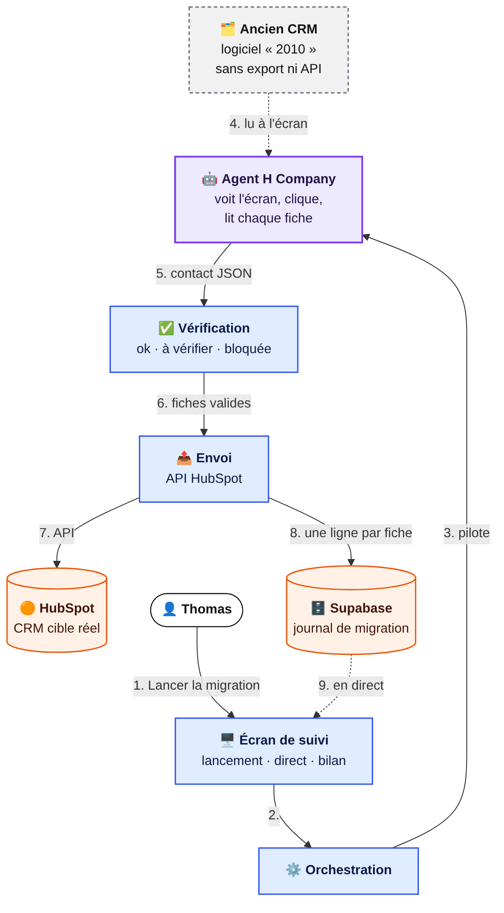

# Bascule — Architecture technique

> Livrable 2 (mercredi 18/11). État au **mardi 17/11 au soir** : toutes les briques fonctionnent de bout en bout.
> Décisions de cadrage : [CADRAGE.md](../CADRAGE.md) (D1 à D11).

## 1. Le principe

**L'agent H Company n'intervient que là où c'est indispensable : lire l'ancien CRM, qui n'a ni API ni export.** Tout le reste passe par du code classique, plus fiable et gratuit : la vérification, l'envoi dans HubSpot par son API et le suivi.

## 2. Le parcours d'une fiche

Les numéros correspondent au schéma.

| # | Étape | Brique | Technologie |
|---|---|---|---|
| 1 | Thomas clique sur **« Lancer la migration »** | Écran de suivi (`apps/dashboard`) | Next.js sur Vercel |
| 2 | L'écran crée un `run_id` et appelle l'orchestration | Orchestration (`agent/runner`) | API HTTP |
| 3 | L'orchestration lance l'agent avec nos instructions | Instructions (`agent/prompts`) | Agent API H Company |
| 4 | L'agent ouvre l'ancien CRM, clique sur chaque fiche et lit l'écran, **comme un humain** | Ancien CRM (`apps/legacy-crm`) | Navigation visuelle |
| 5 | L'agent renvoie le contact au **format commun** (9 champs) | — | JSON ([`contact.schema.json`](../../shared/contact.schema.json)) |
| 6 | La vérification nettoie la fiche et la classe **ok / à vérifier / bloquée** ; seules les fiches ok et à vérifier continuent | Vérification (`pipeline/verification`) | Python, règles |
| 7 | Le contact est créé dans HubSpot, ou mis à jour s'il existe déjà (upsert sur `bascule_legacy_id`) | Envoi (`pipeline/hubspot`) | API HubSpot |
| 8 | Une ligne par fiche est écrite dans le journal : statut, anomalies, durée, coût | Supabase (`migration_log`) | PostgreSQL |
| 9 | L'écran affiche chaque fiche en direct, puis le **bilan** | Écran de suivi | Next.js |

L'ancien CRM lit ses propres données dans la table Supabase `legacy_contacts`, côté serveur. **L'agent n'y a jamais accès** : il ne voit que l'écran.

## 3. Les briques

| Brique | Dossier | Rôle | Responsable | État |
|---|---|---|---|---|
| Ancien CRM simulé | `apps/legacy-crm/` | Logiciel « de 2010 » : liste paginée, une fiche par page, **aucun export, aucune API** | Victoria → Maxime | ✅ En ligne : v1 et v2 (autres libellés), 100 contacts lus dans Supabase |
| Instructions de l'agent | `agent/prompts/` | Ce que l'agent doit ouvrir, lire et renvoyer ; règles strictes (ne rien inventer, lecture seule) | Inès (intégrées par Alexis) | ✅ Version « zéro configuration » dans `agent/runner/prompts.py`, testée sur v1 et v2 |
| Orchestration et agent H | `agent/runner/` | Lance les agents, récupère les fiches, enchaîne vérification et envoi | Alexis | ✅ 100/100 fiches migrées, 100 % exactes, 31 s et 0,015 $ par fiche |
| Vérification | `pipeline/verification/` | Nettoyage, mapping, doublons, anomalies → ok / à vérifier / bloquée | Inès | ✅ Fusionnée, 14 tests |
| Envoi HubSpot | `pipeline/hubspot/` | Création des contacts par l'API, sans doublon, et écriture du journal | Alexis | ✅ Fusionné, testé sur HubSpot |
| Base Supabase | `supabase/` | `legacy_contacts` (base cachée de l'ancien CRM, **100 contacts**) et `migration_log` (journal et mesures) | Alexis | ✅ En ligne |
| Écran de suivi | `apps/dashboard/` | Lancement, suivi en direct, bilan | Inès | ✅ En ligne, branché sur la vraie migration (`?run=tout`) |
| Mesures | `pipeline/metrics/` | Taux de réussite par fiche et par champ, temps et coût par fiche, extrapolation à 3 000 fiches | Alexis | ✅ Calculées sur la vraie migration |

## 4. Les choix techniques

| Choix | Pourquoi |
|---|---|
| **Agent H Company uniquement pour lire l'ancien CRM** | Sans API ni export, l'écran est la seule porte d'entrée. Ailleurs, une API est plus rapide, plus fiable et gratuite. |
| **Ancien CRM simulé, CRM cible réel** | On maîtrise la démo et on prouve l'absence d'export ; HubSpot montre un vrai cas de migration. |
| **Format commun de 9 champs** | Chaque brique peut être construite et testée en parallèle, sans attendre l'agent. |
| **L'agent recopie sans corriger** | La vérification nettoie après lui : on peut mesurer ce qu'il a vraiment lu. |
| **Vérification par règles, sans IA** | Contrôles simples et explicables (e-mail, téléphone, doublons) : coût nul et résultat prévisible. |
| **Upsert sur `bascule_legacy_id`** | Relancer une migration met à jour les contacts au lieu de créer des doublons. |
| **Supabase pour le journal** | Sur Vercel, aucun fichier n'est conservé : il faut une base pour garder les mesures. |

## 5. Sécurité

- **L'agent n'a jamais accès à la base** : il ne voit que ce qu'un humain verrait à l'écran.
- **Lecture seule** : les instructions interdisent tout clic sur « Enregistrer », « Modifier » ou « Supprimer ».
- **Aucune clé dans Git** : clés H Company, HubSpot et Supabase dans `.env.local` et dans Vercel uniquement.
- **Supabase verrouillé** (RLS sans politique publique) : seul le serveur, avec la clé secrète, lit et écrit.
- **Données 100 % fictives** : e-mails en `.example.com`, téléphones dans la plage réservée à la fiction.
- **Serveurs européens** pour l'Agent API H Company.

## 6. Liens

| | Adresse |
|---|---|
| Ancien CRM simulé (v1 · v2) | https://projet-hackathon-uffi.vercel.app · https://projet-hackathon-uffi.vercel.app/v2 |
| Écran de suivi (vraie migration) | https://projet-hackathon-jow2.vercel.app/?run=tout |

---

*Source du schéma : [`architecture.mmd`](architecture.mmd) (Mermaid). Pour régénérer l'image : `npx -p @mermaid-js/mermaid-cli mmdc -i architecture.mmd -o architecture.png -s 2 -b white`.*
