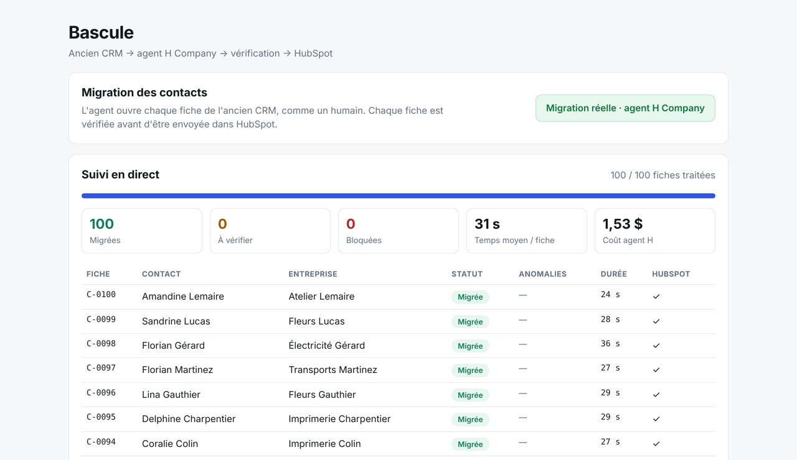
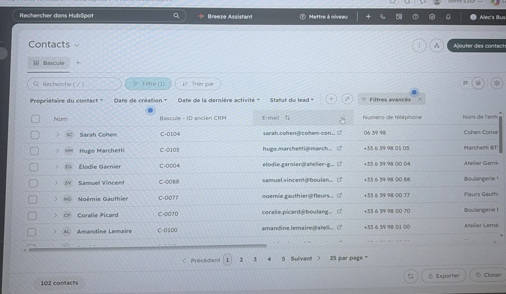
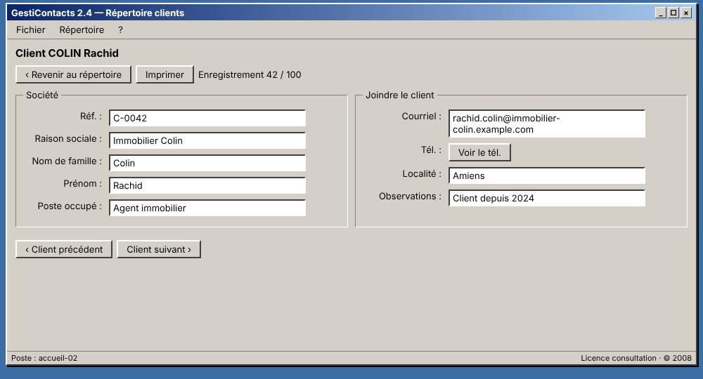

# Checkpoint 2 — Point intermédiaire

**Projet :** Bascule — *Changez de logiciel, sans perdre vos données.*
**Événement :** Hackathon Eugenia 2026 « Build The Future »
**Échéance :** mercredi 18 novembre 2026, avant 17h00

---

## Contenu du livrable

📄 **Les 4 slides demandées (PDF) : [Bascule-livrable2-slides.pdf](Bascule-livrable2-slides.pdf)** · [téléchargement direct](https://github.com/saponealexis1-netizen/Projet_hackathon/raw/main/docs/checkpoint-2/Bascule-livrable2-slides.pdf)

| # | Élément demandé | Où | Responsable | État |
|---|---|---|---|---|
| 01 | **Parcours utilisateur** | [parcours-utilisateur.md](../parcours/parcours-utilisateur.md) | Maxime | ✅ Version finale |
| 02 | **Architecture technique** | [architecture/README.md](../architecture/README.md) · [schéma (PNG)](../architecture/architecture.png) | Inès (à la place de Victoria) | ✅ Version finale |
| 03 | **Mini pitch vidéo** (2 min max) | [bascule-avancement.mp4](bascule-avancement.mp4) (2 min) · [téléchargement direct](https://github.com/saponealexis1-netizen/Projet_hackathon/raw/main/docs/checkpoint-2/bascule-avancement.mp4) | Inès (voix) · Alexis (tournage) | ✅ Version finale, tournée sur le vrai prototype le 18/11 |
| 04 | **Roadmap** jusqu'à jeudi | [roadmap.md](roadmap.md) | Maxime (mise à jour : Alexis) | ✅ À jour (mercredi 18/11) |

## Mini pitch vidéo (2 min)

🎥 **[bascule-avancement.mp4](https://github.com/saponealexis1-netizen/Projet_hackathon/blob/main/docs/checkpoint-2/bascule-avancement.mp4)** · [téléchargement direct](https://github.com/saponealexis1-netizen/Projet_hackathon/raw/main/docs/checkpoint-2/bascule-avancement.mp4) — voix : Inès

> GitHub n'affiche pas les vidéos dans la page : cliquer sur **téléchargement direct**, la vidéo se télécharge puis s'ouvre.

Tournée sur le vrai prototype, le 18/11 : l'ancien CRM sans export, **une vraie migration lancée en un clic**, les agents H Company en direct, les preuves, une fiche piège bloquée, la réparation automatique quand HubSpot refuse une fiche, le bilan, les chiffres et les contacts arrivés dans HubSpot.

## Avancement réel : la migration complète fonctionne

**Depuis mardi 17/11 au soir, le parcours complet tourne de bout en bout, en ligne :**
ancien CRM sans export → **agent H Company** qui lit chaque fiche à l'écran → vérification → **HubSpot** → journal Supabase → écran de suivi.

### Mercredi 18/11 : ce qui s'est ajouté

| Avancée | Preuve |
|---|---|
| **Deuxième logiciel migré sans rien reconfigurer** : la v2 de l'ancien CRM (autre mise en page, autres libellés) | **105 fiches lues, 100/100 exactes**, en **16,9 min** mesurées avec 3 agents (médiane 21 s par fiche), **0,87 $** au total (~0,008 $ par fiche) |
| **Fiches pièges** : doublon, e-mail invalide, prénom vide, téléphone incomplet, majuscules | **5 / 5 traitées comme prévu** : 3 bloquées avant HubSpot, 2 envoyées « à vérifier ». Aucune donnée fausse dans HubSpot |
| **La vraie migration en un clic** : le bouton « Lancer la migration » de l'écran de suivi lance l'agent H (via une action GitHub, rien à installer) | Testé en réel : 6 fiches (C-0004 + les 5 pièges), toutes traitées comme prévu, la dernière arrivée en ~2 min 10 s, 0,11 $ |
| **Suivi en direct** : les fiches arrivent une par une, et un panneau « Agents en direct » montre l'écran des agents pendant qu'ils lisent | Écran de suivi en ligne |
| **Bascule se répare tout seul quand HubSpot change** : si HubSpot refuse une fiche, deux IA corrigent la correspondance des champs (« skill HubSpot »), des garde-fous vérifient, la fiche repart | Panne volontaire (champ HubSpot disparu) : **« envoyée après correction »**, et la fiche suivante passe directement. 1er essai : l'IA s'est trompée, les garde-fous l'ont bloquée (rien de faux envoyé) ; corrigé, puis 2 essais réussis |

### Mardi 17/11 : la première migration complète (v1, 100 fiches)

#### Les chiffres (100 fiches)

| Mesure | Résultat |
|---|---|
| Fiches migrées dans HubSpot | **100 / 100** |
| Fiches **100 % exactes** (9 champs sur 9, comparés à la base d'origine) | **100 / 100** |
| Fiches bloquées à tort / envoyées avec une erreur | **0** |
| Temps moyen de l'agent par fiche | **31 s** |
| Durée réelle de la migration des 100 fiches (3 agents en parallèle) | **33 min** mesurées ; ~20 s perdues par fiche à cause de notre code d'attente, corrigé depuis → **16,9 min** mesurées mercredi sur la v2 (105 fiches) |
| Coût Agent API H Company | **1,53 $ au total**, soit **~0,015 $ par fiche** |
| Extrapolation à 3 000 fiches | **~46 $** · ~8,7 h avec 3 agents (~2,6 h avec 10, offre Builder) |

Mesures calculées à partir du journal `migration_log` par [`pipeline/metrics/`](../../pipeline/metrics/) ; détail des lancements dans [`agent/runner/README.md`](../../agent/runner/README.md).

### À voir en ligne

| | Adresse |
|---|---|
| Ancien CRM simulé, v1 « CRM Agence 2010 » | https://projet-hackathon-uffi.vercel.app |
| Ancien CRM simulé, v2 « GestiContacts 2.4 » (autre mise en page, autres libellés) | https://projet-hackathon-uffi.vercel.app/v2 |
| **Écran de suivi de la vraie migration** (état de chaque fiche, preuves, bilan, bouton de lancement) | https://projet-hackathon-jow2.vercel.app/?run=tout |

*Dans HubSpot (vue « Bascule ») : 102 contacts migrés, chacun relié à sa fiche d'origine par la colonne « Bascule - ID ancien CRM ». Les fiches pièges bloquées n'y sont pas.*

| Ancien CRM v1 : liste, pagination, « Message du jour » à fermer | Ancien CRM v2 : autres libellés, téléphone derrière « Voir le tél. » |
|---|---|
|  |  |

### Ce qui rend l'agent spécifique (déjà démontré)

| Capacité | Preuve |
|---|---|
| **Zéro configuration** (D12) : l'agent ne reçoit que l'adresse ; il trouve la liste, passe les pages, ferme les fenêtres, ouvre les onglets et clique sur « Afficher le numéro » | Le **même agent, sans changer une ligne**, lit la v1 et la v2 de l'ancien CRM (fiches 9/9 exactes sur les deux) |
| **Contrôle d'identité + relance** | L'agent a ouvert une fiche au numéro proche 3 fois sur la v1 (C-0007 au lieu de C-0070) et 1 fois sur la v2 (C-0009 au lieu de C-0090). Toutes **bloquées avant HubSpot**, puis relancées automatiquement : toutes exactes |
| **Preuve visuelle** (D14) | Chaque fiche migrée garde la session de l'agent et sa **capture d'écran** dans `migration_log` |

### Ce qui a cassé, et ce qu'on a corrigé (retour d'expérience Agent API)

| Problème observé | Cause | Correction |
|---|---|---|
| Un téléphone **inventé** | La capture a montré que l'agent n'avait jamais cliqué sur « Afficher le numéro » | Consigne : « une valeur n'est valable que si tu la vois à l'écran » → 9/9 |
| Un chiffre mal lu (« 39 » → « 99 ») | Lecture de l'image | Mode visuel **avec le texte de la page** (`markdown: true`) → 9/9, et plus rapide |
| 1er essai sur 5 fiches : 1/5 | L'agent rangeait toute la fiche dans le champ « notes » | Format de réponse simplifié + filets de sécurité → 5/5 |
| 3 fiches sur 100 confondues (C-0070 / C-0007) | Numéros proches dans la liste | Contrôle d'identité + relance automatique → 100/100 |
| La relecture d'un champ effaçait le reste de la fiche (fiche piège C-0102) | Bug de notre code, trouvé par les tests de pièges | La relecture ne remplace plus que le champ relu |
| La réparation automatique écrivait la correspondance à l'envers | L'IA inversait clés et valeurs ; les garde-fous l'ont bloquée | Remise en forme par le code + consigne précise → réparation réussie |

## Conformité aux attentes Eugenia

| Élément demandé | Format attendu | ✓ |
|---|---|---|
| Parcours utilisateur | Maquette Figma, Miro, Airtable Interface ou schéma | ✅ Schéma Mermaid et tableaux dans le parcours |
| Architecture technique | Simple, même dessinée à la main | ✅ Schéma + explication |
| Mini pitch | Loom, 2 min max : problème + solution + avancement | ✅ Vidéo de 2 min dans le dépôt (Loom ne fonctionnait pas) |
| Roadmap | Jusqu'à jeudi | ✅ Avancement réel + mercredi et jeudi |

> Les cases passent à ✅ au moment du dépôt, une fois chaque élément relu.

## Avant le dépôt (mercredi, avant 17h)

👉 **Checklist détaillée, horaires, vérification des liens et message de dépôt : [checklist-depot.md](checklist-depot.md).**

- [x] Le schéma d'architecture est fusionné et lié ci-dessus.
- [x] Le tableau « Les briques » de l'architecture reflète l'état réel.
- [x] La roadmap reflète l'avancement réel.
- [x] La vidéo est enregistrée (2 min, voix d'Inès) et liée ci-dessus.
- [x] Tous les liens de cette page s'ouvrent depuis une fenêtre de navigation privée (vérifiés le 18/11).
- [ ] Alexis dépose le livrable.
