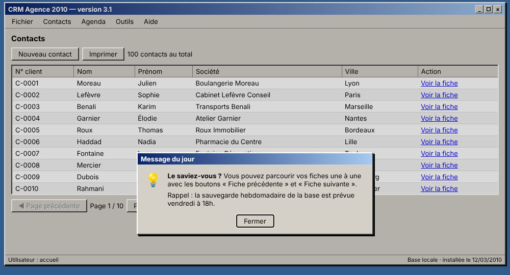

# Checkpoint 2 — Point intermédiaire

**Projet :** Bascule — *Changez de logiciel, sans perdre vos données.*
**Événement :** Hackathon Eugenia 2026 « Build The Future »
**Échéance :** mercredi 18 novembre 2026, avant 17h00

---

## Contenu du livrable

| # | Élément demandé | Où | Responsable | État |
|---|---|---|---|---|
| 01 | **Parcours utilisateur** | [parcours-utilisateur.md](../parcours/parcours-utilisateur.md) | Maxime | ✅ Version finale |
| 02 | **Architecture technique** | [architecture/README.md](../architecture/README.md) · [schéma (PNG)](../architecture/architecture.png) | Inès (à la place de Victoria) | ✅ Version finale |
| 03 | **Mini pitch Loom** (2 min max) | [bascule-mini-pitch.mp4](bascule-mini-pitch.mp4) (1 min 43) · script : [script-loom.md](script-loom.md) | Inès (script de Maxime) | ✅ Version finale, enregistrée mardi 17/11 |
| 04 | **Roadmap** jusqu'à jeudi | [roadmap.md](roadmap.md) | Maxime (mise à jour : Alexis) | ✅ À jour (mardi soir) |

## Mini pitch

🎥 **Vidéo (1 min 43) :** [bascule-mini-pitch.mp4](https://github.com/saponealexis1-netizen/Projet_hackathon/blob/main/docs/checkpoint-2/bascule-mini-pitch.mp4) · [téléchargement direct](https://github.com/saponealexis1-netizen/Projet_hackathon/raw/main/docs/checkpoint-2/bascule-mini-pitch.mp4)

> Enregistrée avec l'enregistreur d'écran (Loom ne fonctionnait pas), puis déposée dans le dépôt GitHub : elle s'ouvre sans compte.
> La vidéo a été tournée **mardi midi, avant la première vraie migration** : l'écran de suivi y apparaît en mode démo. **L'avancement réel, obtenu depuis, est détaillé juste en dessous.**

## Avancement réel : la migration complète fonctionne

**Mardi 17/11 au soir, le parcours complet tourne de bout en bout, en ligne :**
ancien CRM sans export → **agent H Company** qui lit chaque fiche à l'écran → vérification → **HubSpot** → journal Supabase → écran de suivi.

### Les chiffres de la vraie migration (100 fiches)

| Mesure | Résultat |
|---|---|
| Fiches migrées dans HubSpot | **100 / 100** |
| Fiches **100 % exactes** (9 champs sur 9, comparés à la base d'origine) | **100 / 100** |
| Fiches bloquées à tort / envoyées avec une erreur | **0** |
| Temps moyen de l'agent par fiche | **31 s** (3 agents en parallèle : ~17 min pour les 100) |
| Coût Agent API H Company | **1,53 $ au total**, soit **~0,015 $ par fiche** |
| Extrapolation à 3 000 fiches | **~46 $** · ~8,7 h avec 3 agents (~2,6 h avec 10, offre Builder) |

Mesures calculées à partir du journal `migration_log` par [`pipeline/metrics/`](../../pipeline/metrics/) ; détail des lancements dans [`agent/runner/README.md`](../../agent/runner/README.md).

### À voir en ligne

| | Adresse |
|---|---|
| Ancien CRM simulé, v1 « CRM Agence 2010 » | https://projet-hackathon-uffi.vercel.app |
| Ancien CRM simulé, v2 « GestiContacts 2.4 » (autre mise en page, autres libellés) | https://projet-hackathon-uffi.vercel.app/v2 |
| **Écran de suivi de la vraie migration** | https://projet-hackathon-jow2.vercel.app/?run=tout |

| Ancien CRM v1 : liste, pagination, « Message du jour » à fermer | Ancien CRM v2 : autres libellés, téléphone derrière « Voir le tél. » |
|---|---|
|  |  |

### Ce qui rend l'agent spécifique (déjà démontré)

| Capacité | Preuve |
|---|---|
| **Zéro configuration** (D12) : l'agent ne reçoit que l'adresse ; il trouve la liste, passe les pages, ferme les fenêtres, ouvre les onglets et clique sur « Afficher le numéro » | Le **même agent, sans changer une ligne**, lit la v1 et la v2 de l'ancien CRM (fiches 9/9 exactes sur les deux) |
| **Contrôle d'identité + relance** | Sur 100 fiches, l'agent a ouvert 3 fois une fiche au numéro proche (C-0007 au lieu de C-0070). Les 3 ont été **bloquées avant HubSpot**, puis relancées automatiquement : 3/3 exactes |
| **Preuve visuelle** (D14) | Chaque fiche migrée garde la session de l'agent et sa **capture d'écran** dans `migration_log` |

### Ce qui a cassé, et ce qu'on a corrigé (retour d'expérience Agent API)

| Problème observé | Cause | Correction |
|---|---|---|
| Un téléphone **inventé** | La capture a montré que l'agent n'avait jamais cliqué sur « Afficher le numéro » | Consigne : « une valeur n'est valable que si tu la vois à l'écran » → 9/9 |
| Un chiffre mal lu (« 39 » → « 99 ») | Lecture de l'image | Mode visuel **avec le texte de la page** (`markdown: true`) → 9/9, et plus rapide |
| 1er essai sur 5 fiches : 1/5 | L'agent rangeait toute la fiche dans le champ « notes » | Format de réponse simplifié + filets de sécurité → 5/5 |
| 3 fiches sur 100 confondues (C-0070 / C-0007) | Numéros proches dans la liste | Contrôle d'identité + relance automatique → 100/100 |

## Conformité aux attentes Eugenia

| Élément demandé | Format attendu | ✓ |
|---|---|---|
| Parcours utilisateur | Maquette Figma, Miro, Airtable Interface ou schéma | ✅ Schéma Mermaid et tableaux dans le parcours |
| Architecture technique | Simple, même dessinée à la main | ✅ Schéma + explication |
| Mini pitch | Loom, 2 min max : problème + solution + avancement | ✅ Vidéo de 1 min 43 dans le dépôt |
| Roadmap | Jusqu'à jeudi | ✅ Avancement réel + mercredi et jeudi |

> Les cases passent à ✅ au moment du dépôt, une fois chaque élément relu.

## Avant le dépôt (mercredi, avant 17h)

👉 **Checklist détaillée, horaires, vérification des liens et message de dépôt : [checklist-depot.md](checklist-depot.md).**

- [x] Le schéma d'architecture est fusionné et lié ci-dessus.
- [x] Le tableau « Les briques » de l'architecture reflète l'état réel.
- [x] La roadmap reflète l'avancement réel.
- [x] La vidéo est enregistrée (1 min 43) et liée ci-dessus.
- [ ] Tous les liens de cette page s'ouvrent depuis une fenêtre de navigation privée.
- [ ] Alexis dépose le livrable.
