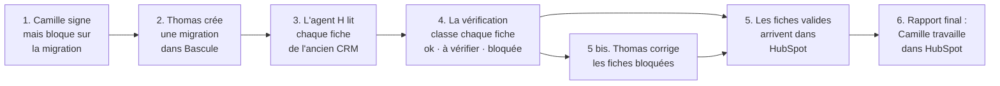

# Bascule — Parcours utilisateur

> **Brouillon v1 du 16/11/2026.** Version finale pour le livrable de mercredi 17h (`docs/checkpoint-2/`).
> Personas : voir [README](../../README.md#personas). Cadrage technique : voir [CADRAGE.md](../CADRAGE.md).

---

## 1. Les deux personnes du parcours

| | **Thomas** — celui qui lance la migration | **Camille** — celle dont les données migrent |
|---|---|---|
| Qui | Responsable onboarding chez un éditeur CRM ou une agence partenaire HubSpot | Gérante d'une petite agence, cliente de Thomas |
| Ce qu'il/elle fait dans Bascule | Lance, suit et valide la migration | Presque rien : elle donne un accès en lecture seule et continue à travailler |
| Ce qu'il/elle veut | « La migration ne devrait pas bloquer une vente. » | « Je veux changer d'outil, pas tout recopier. » |
| Sa peur | Une migration longue qui retarde la signature | Perdre des données, ou qu'elles fuient |

## 2. Le parcours en un coup d'œil

## 3. Le parcours de Thomas, étape par étape

| # | Étape | Ce que Thomas fait | Ce que Bascule fait | Écran | Ce que ressent Thomas |
|---|---|---|---|---|---|
| 1 | **Le blocage** | Camille, qu'il démarche, est convaincue par HubSpot, mais son vieux logiciel n'a aucun export | — | — | 😟 La vente risque de tomber |
| 2 | **Créer la migration** | Entre l'adresse de l'ancien CRM et les accès en lecture fournis par Camille, choisit HubSpot comme destination | Vérifie que l'ancien CRM s'ouvre | Écran de lancement | 🤔 « Est-ce que ça va marcher ? » |
| 3 | **Lancer** | Clique sur « Lancer la migration » | L'agent H ouvre la liste des contacts, puis chaque fiche, comme un humain | Écran de suivi | 😮 Il voit l'agent travailler en direct |
| 4 | **Suivre** | Regarde le tableau de bord | Affiche en direct : fiches lues, fiches par minute, % de champs corrects, coût, anomalies | Écran de suivi | 😌 Il n'a rien à faire |
| 5 | **Traiter les cas douteux** | Corrige uniquement les fiches bloquées (ex. e-mail mal formé, doublon) | Envoie les fiches `ok` et `à vérifier` vers HubSpot ; garde les fiches bloquées pour Thomas | Écran de suivi → liste des anomalies | 🙂 Il ne traite que quelques fiches au lieu de toutes |
| 6 | **Valider** | Ouvre HubSpot et vérifie quelques contacts | Produit un rapport : fiches migrées, corrigées, rejetées, durée, coût | Rapport final + HubSpot | 🎉 La vente est signée, la cliente est opérationnelle |

## 4. Le parcours de Camille

| Moment | Ce que vit Camille | Ce que Bascule lui apporte |
|---|---|---|
| **Avant** | Elle veut passer sur HubSpot mais redoute de recopier ses contacts un par un | La migration est offerte par Thomas |
| **Pendant** | Elle donne un **accès en lecture seule** à son ancien logiciel et **continue à travailler** | Aucune donnée n'est modifiée dans son ancien logiciel |
| **Après** | Elle retrouve ses contacts dans HubSpot, propres et dédoublonnés | Un rapport clair : ce qui a été migré, corrigé ou mis de côté |

## 5. Les écrans

| Écran | Rôle dans le parcours | Qui le construit |
|---|---|---|
| **Ancien CRM simulé** (« logiciel de 2010 ») | Ce que l'agent lit : liste paginée de contacts, une fiche par page, aucun export | Victoria (`apps/legacy-crm/`) |
| **Écran de lancement** | Thomas entre l'adresse de l'ancien CRM et choisit HubSpot | À décider |
| **Écran de suivi de migration** | Tableau de bord en direct + liste des anomalies | Inès (`apps/dashboard/`) |
| **HubSpot** | Le nouveau CRM où arrivent les contacts | Réel (compte gratuit, envoi par Alexis) |
| **Rapport final** | Bilan : migrées, corrigées, rejetées, durée, coût | À décider (peut être une section de l'écran de suivi) |

### Ce qu'affiche l'écran de suivi

| Indicateur | Source |
|---|---|
| Fiches lues / total | `migration_log` (Supabase) |
| Statut de chaque fiche : ✅ `ok` · ⚠️ `warning` (à vérifier) · ❌ `error` (bloquée) | Vérification (Inès) |
| Liste des anomalies (doublon, e-mail mal formé, champ vide…) | Vérification (Inès) |
| Temps par fiche et coût par fiche | `migration_log` (`duration_ms`, `credits_used`) |
| Lien vers chaque contact créé dans HubSpot | `migration_log` (`hubspot_id`) |

## 6. Ce que Thomas voit sur une fiche

Les 9 champs du contrat commun ([`shared/contact.schema.json`](../../shared/contact.schema.json)) :

| Champ | Exemple | Obligatoire |
|---|---|---|
| Identifiant ancien CRM | C-0042 | ✅ |
| Prénom | Camille | ✅ |
| Nom | Martin | ✅ |
| E-mail | camille.martin@exemple.fr | |
| Téléphone | +33 6 12 34 56 78 | |
| Entreprise | Agence Lumière | |
| Poste | Gérante | |
| Ville | Lyon | |
| Notes | Client depuis 2019 | |

## 7. Le scénario de la démo (vendredi, ~3 min)

| Temps | Ce qu'on montre | Ce qu'on dit |
|---|---|---|
| 0:00 | L'ancien CRM « 2010 » : on cherche le bouton d'export… il n'y en a pas | « Voilà le logiciel de Camille. Aucun export. Imaginez 3 000 contacts. » |
| 0:30 | Thomas lance la migration dans Bascule | « Thomas n'a qu'à cliquer. » |
| 0:45 | 3 agents H ouvrent des fiches en parallèle, en direct | « L'agent lit l'écran comme un humain. » |
| 1:30 | Le tableau de bord se remplit : fiches, %, coût, anomalies | « Il vérifie chaque fiche et signale les problèmes. » |
| 2:15 | Une fiche bloquée (doublon ou e-mail mal formé) : Thomas la corrige | « Thomas ne traite que les cas douteux. » |
| 2:40 | Les contacts apparaissent dans HubSpot | « Camille travaille déjà dans HubSpot. » |

**Timing réaliste** : on a mesuré **~48 s par fiche** et l'offre gratuite H Company permet **3 agents en parallèle par personne**. En 2 minutes de démo, on migre donc **~5 à 6 fiches en direct**. Les 20 fiches de la démo sont lancées **juste avant le pitch** : on montre le lancement en direct, puis le tableau de bord et HubSpot déjà remplis.

**Plan B** : vidéo enregistrée de la même démo si le réseau ou l'agent lâche (tâche de Victoria, jeudi).

## 8. Points à trancher d'ici mercredi

| # | Question | Qui décide |
|---|---|---|
| 1 | Qui construit l'écran de lancement et le rapport final ? | Alexis (chef de projet) |
| 2 | Thomas peut-il corriger une fiche bloquée dans l'écran de suivi, ou seulement la voir ? | Inès + Alexis |
| 3 | Les fiches `warning` partent-elles vers HubSpot avec une note, ou sans ? | Inès + Alexis |
| 4 | Montre-t-on les accès de Camille dans la démo, ou l'ancien CRM est-il ouvert sans mot de passe ? | Victoria |
