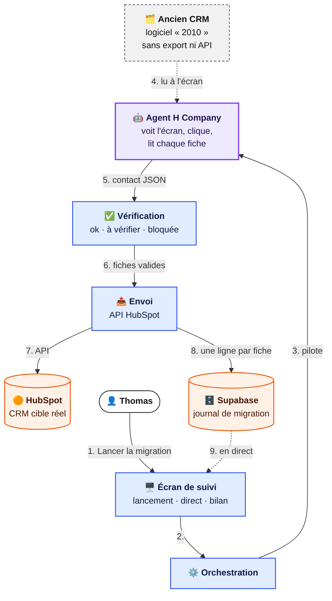

# Bascule — Pitch deck (brouillon)

> **Brouillon du 17/11/2026, mis à jour avec les vrais chiffres** (migrations complètes v1 et v2, voir [retour d'expérience](../retour-agent-api/README.md)). À relire par Alexis. Version finale vendredi avant 15h.
> **Format demandé** : 8 à 12 slides, dans cet ordre : problème, solution, démo, business model, go-to-market, architecture technique, limites et roadmap, coût de run.
> **Temps de parole** : 6 min de pitch + 4 min de questions.

**Légende** : ✅ mesuré ou testé · 📚 source externe · 🔎 hypothèse · `[à remplir]` = à compléter avant vendredi

**Règle de mise en forme** : **15 mots maximum à l'écran par slide** (hors tableaux de chiffres). Le reste se dit à l'oral.

---

## Vue d'ensemble

| # | Slide | Temps |
|---|---|---|
| 1 | Accroche et titre | 0:20 |
| 2 | Problème | 0:35 |
| 3 | Solution | 0:30 |
| 4 | Démo live | 2:00 |
| 5 | Business model | 0:30 |
| 6 | Go-to-market | 0:20 |
| 7 | Architecture technique et Agent API | 0:40 |
| 8 | Limites et roadmap | 0:25 |
| 9 | Coût de run | 0:25 |
| 10 | Équipe et conclusion | 0:15 |
| | **Total** | **6:00** |

---

## Slide 1 — Accroche et titre

**À l'écran** : une capture de l'ancien CRM « 2010 », puis le titre.
- **Bascule** — « Changez de logiciel, sans perdre vos données. »

**Ce qu'on dit**
> « Camille dirige une petite agence. Dans son logiciel installé en 2010, il y a 3 000 fiches clients. Elle veut passer sur HubSpot. Elle cherche le bouton “exporter”… il n'existe pas. Nous sommes Bascule, et nous avons construit l'agent qui la sort de là. »

---

## Slide 2 — Problème

**À l'écran**
- **44 %** des PME : la migration est le premier obstacle 📚
- **3 000 fiches = 100 heures** de ressaisie 🔎
- Pas d'API, pas d'export : **aucun outil de migration ne marche**

**Ce qu'on dit**
> « Camille n'est pas un cas isolé : pour 44 % des PME, la migration des données est le premier obstacle au changement de CRM. Sans export, il reste une option : tout recopier. 3 000 fiches, c'est 100 heures. Et pour Thomas, qui vend HubSpot à Camille, c'est la dernière objection avant la signature. Souvent, la vente tombe. »

---

## Slide 3 — Solution

**À l'écran** : 4 étapes

| 1. Lire | 2. Vérifier | 3. Écrire | 4. Suivre |
|---|---|---|---|
| L'agent lit chaque fiche à l'écran | ok / à vérifier / bloquée | Création dans HubSpot | Migration en direct + bilan |

**Ce qu'on dit**
> « Bascule commence là où les outils de migration s'arrêtent. Pas d'API ? Pas d'export ? Notre agent lit l'écran, comme un humain. Notre application vérifie chaque fiche, n'envoie dans HubSpot que celles qui sont sûres, et Thomas ne traite que les cas douteux. »

---

## Slide 4 — Démo live (2 min)

**À l'écran** : on bascule sur les vraies applications. Scénario détaillé : [parcours utilisateur, section 7](../parcours/parcours-utilisateur.md).

| Temps | On montre |
|---|---|
| 0:00 | L'ancien CRM : on cherche le bouton d'export… il n'y en a pas |
| 0:20 | Thomas clique sur « Lancer la migration » dans l'écran de suivi |
| 0:35 | Les agents H ouvrent les fiches en direct |
| 1:10 | Le tableau de bord se remplit ; une fiche bloquée s'affiche avec sa raison |
| 1:40 | Les contacts sont dans HubSpot |

**À préparer** : la migration complète est lancée **juste avant le pitch** (✅ 105 fiches en 16,9 min avec 3 agents, médiane 21 s par fiche). On montre le lancement en direct de quelques fiches, puis le résultat déjà rempli.

**Plan B** : vidéo enregistrée de la même démo.

---

## Slide 5 — Business model

**À l'écran**
- **Qui paie** : l'éditeur ou l'agence qui vend le nouveau CRM
- **990 €** par client migré (jusqu'à 10 000 fiches) 🔎

**Ce qu'on dit**
> « Ce n'est pas Camille qui paie, c'est Thomas. Chaque migration réussie lui débloque un abonnement, et il facture déjà l'onboarding : entre 1 500 et 3 500 dollars chez HubSpot. Nous lui vendons la migration 490 euros jusqu'à 2 000 fiches, 990 euros jusqu'à 10 000. Pour 3 000 fiches, c'est trois fois moins cher que la ressaisie, et quelques heures au lieu de trois semaines. »

Grille complète (à la fiche, forfait, partenaire) : [business-model.md](business-model.md).

---

## Slide 6 — Go-to-market

**À l'écran**
1. Agences partenaires HubSpot (France)
2. Éditeurs de logiciels métier
3. Application sur la marketplace HubSpot

**Ce qu'on dit**
> « On commence par les agences partenaires HubSpot : elles font l'onboarding des clients et butent sur les migrations chaque semaine. Il y en a entre 6 000 et 7 500 dans le monde, et elles sont toutes listées dans l'annuaire HubSpot. »

---

## Slide 7 — Architecture technique et Agent API

**À l'écran** : le schéma d'architecture.

Détail : [docs/architecture/](../architecture/README.md).

**Ce qu'on utilise de l'Agent API de H Company**

| Fonction | Ce qu'elle nous apporte | État |
|---|---|---|
| Agent qui navigue à l'écran (`h/web-surfer-flash`) | Lire un logiciel sans API ni export, **sans configuration** (il ne reçoit que l'adresse) | ✅ 2 versions de l'ancien CRM migrées |
| Sortie JSON structurée (schéma imposé à la réponse) | Chaque fiche arrive au format du contrat commun, prête à vérifier | ✅ 205 fiches |
| Texte de la page en plus de la capture (`markdown: true`) | Plus d'erreurs de lecture des chiffres | ✅ |
| Plusieurs agents en parallèle | 3 fiches lues en même temps (10 avec l'offre Builder) | ✅ |
| Suivi des sessions (étapes, coût, durée, captures d'écran) | Coût et temps par fiche en direct ; capture de chaque fiche comme preuve | ✅ |
| Nombre maximal d'étapes et de temps par fiche | 40 étapes et 4 min maximum : un agent bloqué n'immobilise pas la migration | ✅ réglé dans `agent/runner` |

**Ce qu'on dit**
> « L'agent H est utilisé là où il est indispensable : lire un logiciel fermé. Il ne reçoit que l'adresse : le même agent, avec les mêmes consignes, a migré deux versions différentes du logiciel. Autour de lui, des garde-fous : format imposé, contrôle de la fiche ouverte, vérification, relecture, et une capture d'écran de chaque fiche comme preuve. Côté HubSpot, on passe par son API : c'est plus fiable. »

---

## Slide 8 — Limites et roadmap

**À l'écran**

| Aujourd'hui (MVP) | Ensuite |
|---|---|
| Contacts uniquement | Notes et pièces jointes |
| Ancien CRM sans mot de passe | Connexion sécurisée (coffre-fort H Company) |
| HubSpot uniquement | Salesforce, Pipedrive, Zoho |

**Ce qu'on dit**
> « Notre MVP migre les contacts, sur un ancien CRM sans mot de passe, vers HubSpot. Les fiches bloquées se corrigent encore à la main. La suite : les notes et pièces jointes, la connexion sécurisée avec le coffre-fort de H Company, et d'autres CRM cibles. »

---

## Slide 9 — Coût de run

**À l'écran**

| | Valeur |
|---|---|
| Fiches exactes | **100 / 100** sur chacune des 2 versions ✅ |
| Coût par fiche | **0,008 à 0,015 $** ✅ |
| 3 000 fiches | **~45 $** de coût · **~8 h** avec 3 agents ✅🔎 |
| Marge sur un forfait de 990 € | **~95 %** |

**Ce qu'on dit**
> « Sur nos deux migrations complètes, 100 fiches exactes sur 100, à chaque fois. Chaque fiche nous coûte entre un et deux centimes. Pour 3 000 fiches, c'est environ 45 dollars de coût pour 990 euros de chiffre d'affaires. Même si ce coût était cinq fois plus élevé, la marge resterait au-dessus de 75 %. »

---

## Slide 10 — Équipe et conclusion

**À l'écran**

| Maxime Bazin | Victoria Ifrah | Inès Soubran | Alexis Sapone | Mehdi Zitouni | Natalia Medrano |
|---|---|---|---|---|---|
| CEO | CTO | CAIO | CDO + chef de projet | CPO | CAO |

- « Changez de logiciel, sans perdre vos données. »

**Ce qu'on dit**
> « Bascule, c'est la migration qui ne bloque plus la vente. Merci ! »

---

## Questions probables du jury

| Question | Réponse courte |
|---|---|
| « Pourquoi un agent plutôt qu'un script ? » | Pas d'API, pas d'export : la seule porte d'entrée est l'écran. Et aucune configuration : le même agent a migré deux versions différentes du logiciel, là où un robot RPA aurait dû être réenregistré. |
| « Et si l'agent se trompe ? » | Il a ouvert la mauvaise fiche 4 fois sur 205 : notre contrôle les a bloquées avant HubSpot, puis l'agent les a relues. Aucune mauvaise fiche n'est partie. Chaque fiche est classée ok / à vérifier / bloquée, et a sa capture d'écran. |
| « Et la sécurité ? » | L'agent ne fait que lire. Serveurs européens de H Company. Coffre-fort à mots de passe prévu après le MVP. |
| « Qui paie, et pourquoi ? » | L'éditeur ou l'agence : il facture déjà l'onboarding, et la migration bloque ses ventes. |
| « Avez-vous parlé à des clients ? » | Pas encore : cette semaine, nous avons prouvé que la technologie marche. Nos prix sont des hypothèses ; la prochaine étape, ce sont des entretiens avec des agences partenaires HubSpot, et nos questions sont prêtes. |
| « Qu'avez-vous appris sur l'Agent API ? » | Qu'il sait naviguer seul dans un logiciel inconnu, mais qu'il préfère inventer une valeur crédible plutôt que laisser vide. On le lui interdit, et on vérifie tout derrière lui : 1 fiche exacte sur 5 sans garde-fous, 100 sur 100 avec. Détail : [retour d'expérience](../retour-agent-api/README.md). |

---

## À faire avant vendredi 15h

- [x] Remplir la slide 9 avec les mesures réelles (v1 et v2)
- [x] Schéma d'architecture sur la slide 7, ligne « nombre maximal d'étapes » confirmée
- [ ] Ajouter les captures : ancien CRM, écran de suivi, HubSpot
- [ ] Mettre en forme les slides (15 mots maximum à l'écran)
- [ ] Chronométrer le pitch à voix haute : 6 min maximum
